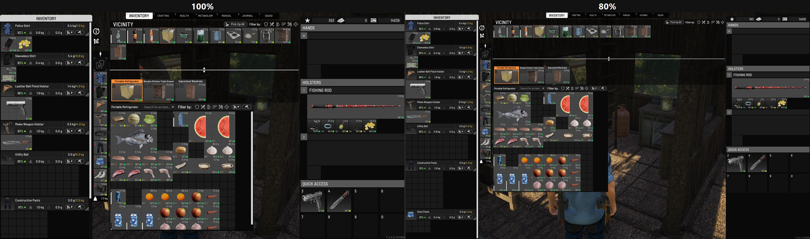

# SCMW — UI Scale

A small **SCUM** mod that makes the interface smaller or bigger while you play,
in 10-point steps. It changes the game's own layout scale, so mouse clicks and
highlights stay on the control you aimed at.

This is a separate project from **SCMW — Lone Wolf**. It does not edit any game
files, and it does not touch the Lone Wolf app.

**Current version:** 1.0.0  
**Tested on:** SCUM 1.3.4.2 (build 25804202) with UE4SS 3.0.1  
**Nexus page:** https://www.nexusmods.com/scum/mods/339  
**Source:** https://github.com/scummoddingworkshop-byte/SCMW-UI-Scale



*The same inventory at 100% and 80%. As the interface shrinks, more of the world becomes visible.*

More: [inventory at 100%](docs/screenshots/01-inventory-100.jpg) ·
[80%](docs/screenshots/02-inventory-80.jpg) ·
[60%](docs/screenshots/03-inventory-60.jpg) ·
[crafting at 60%](docs/screenshots/04-crafting-60.jpg)

---

## Features

- **Ctrl + −** — 10 points smaller
- **Ctrl + +** — 10 points bigger (Ctrl + Shift + + on some keyboards)
- **Ctrl + 0** — back to 100%
- The number-pad **−** and **+** keys work too.
- The chosen size is **remembered between sessions**.
- Works on the inventory, crafting, HUD and the main menus.
- No game files are changed; remove the mod and the interface returns to normal.

The scale ranges from **40%** to **150%**.

---

## Requirements

- **UE4SS** installed in `SCUM\Binaries\Win64`
- SCUM launched with **`-nobattleye -fileopenlog`** (a desktop shortcut is easiest)
- **Single-player or private servers only** — BattlEye must be off, so this
  cannot be used on official servers
- A recent UE4SS 3.x build. Tested with **3.0.1**.

UE4SS is a separate project and is **not** included in this download. Get it
from the official UE4SS releases:
<https://github.com/UE4SS-RE/RE-UE4SS/releases>

---

## Installation

1. Install UE4SS and check that it loads.
2. Extract the release zip into:

   ```
   SCUM\Binaries\Win64
   ```

   The zip already contains the correct `ue4ss\Mods\SCMW_UIScale` folders.

3. Add this line to `SCUM\Binaries\Win64\ue4ss\Mods\mods.txt`:

   ```
   SCMW_UIScale : 1
   ```

4. Launch SCUM from a shortcut that uses:

   ```
   -nobattleye -fileopenlog
   ```

5. Open the inventory and use the keys above.

---

## Saved setting

The chosen size is stored here:

```
%LOCALAPPDATA%\SCUM\Saved\SCMW_UIScale.txt
```

It is per Windows user and survives game updates. Delete the file to start at
**100%** again.

---

## Uninstall

- Set `SCMW_UIScale : 0` in `ue4ss\Mods\mods.txt`, **or**
- delete the `ue4ss\Mods\SCMW_UIScale` folder.

The interface returns to normal on the next launch. Nothing else is changed.

---

## Troubleshooting

After launching, open:

```
SCUM\Binaries\Win64\ue4ss\UE4SS.log
```

Look for lines starting with `[SCMW]`. They show the loaded version, the saved
scale, the applied scale, and any file or settings error.

If the keys do nothing, check that UE4SS itself loaded and that SCUM was started
with `-nobattleye -fileopenlog`. Steam's normal Play button does not load UE4SS.

---

## Building the release zip

From the repository root, run:

```powershell
powershell -ExecutionPolicy Bypass -File .\build.ps1
```

The zip is written to `dist\SCMW_UIScale_v1.0.0.zip` and contains:

```
ue4ss/
└── Mods/
    └── SCMW_UIScale/
        ├── Scripts/
        │   └── main.lua
        ├── LICENSE.txt
        └── README.txt
```

The build script checks that the expected files are present and prints the zip
contents.

---

## How it works

SCUM uses Unreal's `UUserInterfaceSettings` to control the interface scale. The
mod finds that live settings object and changes `ApplicationScale` in 10-point
steps. Because this is a real layout scale, the game's mouse hit testing matches
the picture — unlike a render transform, which can leave clicks behind.

The setting is written to a small text file in the player's SCUM saved folder.

---

## License

**MIT License.** See `LICENSE`.

You may use, modify and redistribute this mod, including commercially, as long
as the copyright notice and the licence text stay with it. **Attribution is the
only requirement.**

---

## Credits

- **Fran (SCMW)** — project owner and testing
- **UE4SS** — the Lua mod loader that makes this possible
- **SCUM** — Gamepires / Jagex
